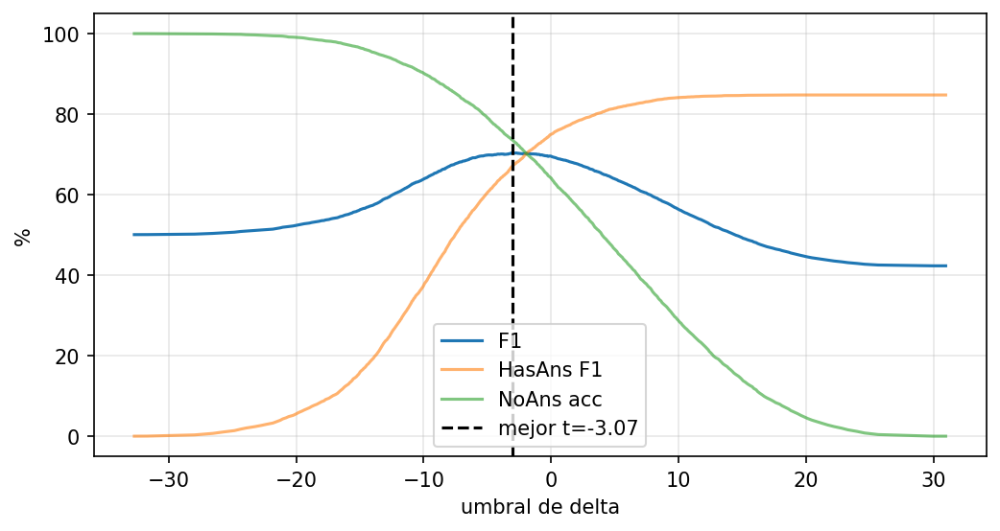

# Final-model calibration evidence

Javier supplied `drive-download-20261101T035014Z-1-001.zip` containing the
threshold sweep, its figure and per-example validation predictions. The CSV and
PNG here are byte-for-byte copies. Existing `eval_summary.json` was not changed.

| File | Evidence |
|---|---|
| `threshold_sweep.csv` | All 504 evaluated thresholds and their EM, F1, HasAns F1, NoAns accuracy and predicted-null rate. |
| `threshold_sweep.png` | Supplied plot; visually consistent with the CSV, including the optimum marked at approximately -3.07. |
| `postprocess_config.json` | Exact copy of the local served model's configuration; threshold and metrics match the final evaluation. |
| `calibration_verification.json` | Source hashes, counts, checked metrics and limitations of this inspection. |

The best CSV row exactly matches `eval_summary.json`: threshold
**-3.0664472656250004**, EM **67.57348606081024%**, F1 **70.38989730396112%**.
The threshold-zero row also matches exactly. Calibration improves F1 by
**0.85104174525463 points**. With no abstention, HasAns F1 is
**84.76402413792007%** and overall F1 **42.32132865237011%**.
All sampled thresholds from **-4.444375000000001** through
**-0.924187499999995** are within 0.5 F1 points of the best sampled value;
this is not a claim about every untested value between grid points.

The supplied prediction JSON contains 11,873 unique IDs: 5,928 answerable and
5,945 unanswerable. Inspection verified `delta = null_score - span_score`,
reconstructed the evaluator's entire quantile threshold grid, and reproduced
the null rate and NoAns accuracy for every CSV row. Every global F1 also matches
the weighted HasAns F1 and NoAns accuracy. All candidates have nonempty text
and a start offset. These are pre-threshold candidates, not final null decisions.

The original `validation_predictions.json` is 2,825,770 bytes. To keep the
documentation compact, it remains in the supplied ZIP and locally at
`tmp/qa-calibration-inspection/validation_predictions.json` (ignored by Git).
Its SHA-256 and aggregate checks are preserved in `calibration_verification.json`.
The CSV, figure and compact audit support the report without adding the full
per-example export.

EM and answerable F1 were checked for agreement between supplied artifacts,
not independently rescored: the prediction JSON does not include gold answer
texts or contexts. Consequently, exact substring offsets were not revalidated
for the full validation split. Checkpoint identity remains team-confirmed;
these files do not embed a model hash. No model inference, training, threshold
recalibration or dataset download was performed during this inspection.
